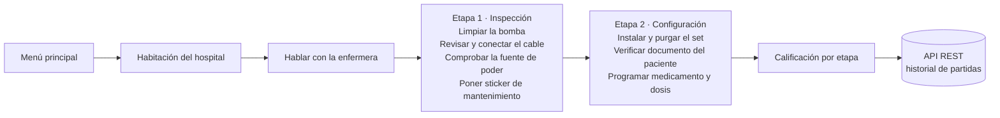
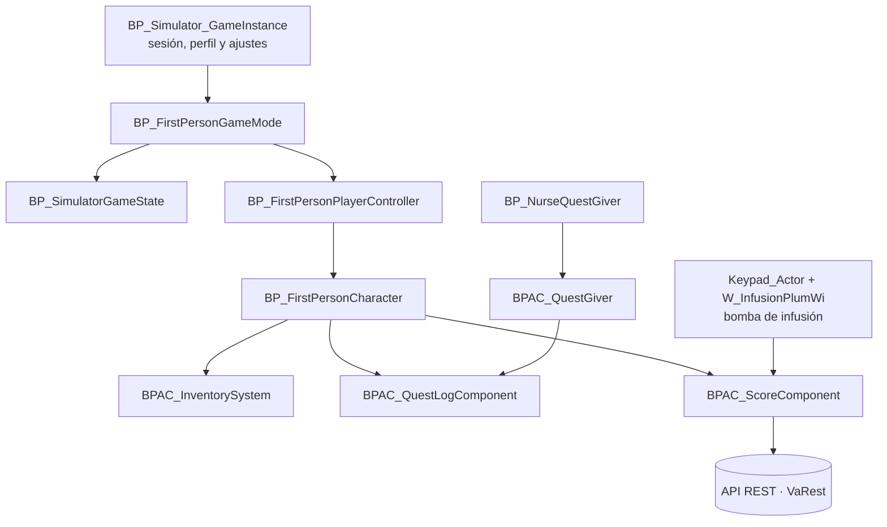

<div align="center">

# Virtual Hospital ITM — Simulador de Bomba de Infusión

**Simulador clínico en primera persona desarrollado en Unreal Engine 5 para entrenar el procedimiento de verificación, configuración y uso de una bomba de infusión.**


</div>

[](https://github.com/JuanAvendan/infusion-pump-simulator-ue5/releases/latest)

<!--
  TODO: agrega aquí una captura principal o un GIF del simulador.
  Ejemplo:
  <p align="center"></p>
-->

---

## Tabla de contenido

- [Sobre el proyecto](#sobre-el-proyecto)
- [Características](#características)
- [Flujo del escenario](#flujo-del-escenario)
- [Capturas](#capturas)
- [Arquitectura](#arquitectura)
- [Tecnologías](#tecnologías)
- [Requisitos](#requisitos)
- [Instalación y ejecución](#instalación-y-ejecución)
- [Controles](#controles)
- [Estructura del repositorio](#estructura-del-repositorio)
- [Equipo](#equipo)
- [Estado y roadmap](#estado-y-roadmap)
- [Créditos de assets y licencia](#créditos-de-assets-y-licencia)

---

## Sobre el proyecto

**Virtual Hospital ITM** (nombre interno: *LabSimulator*) es un simulador educativo desarrollado en el marco de un **semillero de investigación del Instituto Tecnológico Metropolitano (ITM)**, Medellín, Colombia.

El objetivo es que estudiantes del área biomédica y de la salud practiquen, en un entorno seguro y repetible, el protocolo para dejar una **bomba de infusión** lista para un paciente: inspeccionar el equipo, conectarlo, instalar y purgar el set de infusión, verificar la identidad del paciente y programar el medicamento con la dosis correcta. Cada acción se evalúa y al final se entrega una calificación por etapa.

El jugador recorre una habitación de hospital en primera persona, habla con la enfermera para recibir el caso, usa un inventario con los insumos necesarios y opera la bomba mediante su panel y teclado virtuales.

## Características

**Simulación clínica**
- Escenario guiado *"Bomba de Infusión"* dividido en etapas con objetivos (inspección → configuración).
- Interacción física con la bomba: limpieza, conexión del cable de poder, instalación del set de infusión, purga y programación de dosis en un teclado (keypad) virtual.
- Datos de pacientes y medicamentos (documento, edad, medicamento, dosis, velocidad y tiempo de infusión) modelados con *structs* y *Data Tables*.
- Sticker de mantenimiento editable y hoja de medicamentos consultable dentro del juego.

**Sistemas de gameplay**
- **Sistema de misiones** propio (Quest Giver, Quest Log y Quest Tracker) con etapas, objetivos y texto enriquecido.
- **Sistema de puntuación** por etapa, pantalla de resultados al finalizar e historial de partidas.
- **Inventario** con cuadrícula, *drag & drop*, *hotbar* con atajos numéricos y generador de íconos por *render target*.
- Sistema de interacción basado en interfaces de Blueprint (`BPI_InteractInterface`), con puntos de interés y mensajes contextuales.
- NPC de enfermera con diálogo que entrega el caso clínico.

**Interfaz y experiencia**
- Menú principal, perfil de usuario, tutorial, pantallas de carga con consejos aleatorios y menú de pausa.
- Ajustes de gráficos, audio (Sound Classes / Sound Mixes) y reasignación de teclas (Enhanced Input).
- Lobby y creación de sesiones multijugador mediante el plugin AdvancedSessions.

**Persistencia e integración**
- Perfil del jugador guardado localmente con `SaveGame`.
- Comunicación con una **API REST** (plugin VaRest) para registrar usuarios, partidas y resultados del escenario.

**Arte y entorno**
- Hospital modelado con Megascans, assets del Marketplace/Fab y modelos propios.
- Personajes con MetaHumans y animaciones de Mixamo; iluminación con Lumen y Nanite.

## Flujo del escenario



## Capturas

<!--
  TODO: reemplaza estos comentarios por capturas reales (guárdalas en docs/images/).
  Sugerencias: menú principal, habitación del hospital, panel de la bomba, inventario,
  quest tracker y pantalla de calificación. Un video corto en YouTube aporta mucho:
  [](https://youtu.be/TU_VIDEO)
-->

| Menú principal | Habitación del hospital |
| :---: | :---: |
| <!--  --> *Próximamente* | <!--  --> *Próximamente* |
| **Panel de la bomba de infusión** | **Calificación final** |
| <!--  --> *Próximamente* | <!--  --> *Próximamente* |

## Arquitectura

El proyecto está construido principalmente con **Blueprints**, organizado en componentes reutilizables que se acoplan al personaje y a los actores del nivel:



| Módulo | Ubicación | Responsabilidad |
| --- | --- | --- |
| Frameworks | `Content/Frameworks` | Game Instance, Game State, Player State y controladores de menú |
| Misiones | `Content/QuestSystem` | Misiones, etapas, objetivos, tracker y log |
| Puntuación | `Content/QuestSystem/ScoreSystem` | Evaluación por etapa e historial |
| Inventario | `Content/Inventory` | Ítems, slots, *drag & drop*, hotbar e íconos |
| Bomba de infusión | `Content/Panel`, `Content/AlbertoAddons/InfusionLine` | Panel, keypad y línea de infusión (*spline*) |
| Menús y UI | `Content/MainMenu`, `Content/HUD` | Menús, ajustes, tutorial, carga y HUD |
| Guardado | `Content/SavedData` | Perfil del jugador (`SaveGame`) |
| Escenarios | `Content/Escenarios` | Mapas del menú, hospital, lobby y pantalla de carga |

## Tecnologías

| Área | Herramientas |
| --- | --- |
| Motor | Unreal Engine 5.6 (Lumen, Nanite, Virtual Shadow Maps) |
| Lógica | Blueprints, Enhanced Input, UMG, interfaces de Blueprint, Data Tables |
| Plugins | [VaRest](https://github.com/ufna/VaRest) (REST/JSON), [AdvancedSessions](https://github.com/mordentral/AdvancedSessionsPlugin) (sesiones), Geometry Scripting, Modeling Tools |
| Personajes | MetaHumans (RigLogic, Hair Strands), Mixamo |
| Arte | Quixel Megascans, Starter Content, assets de Fab/Marketplace |
| Control de versiones | Git, GitLab → GitHub |

## Requisitos

- **Windows 10/11** de 64 bits.
- **Unreal Engine 5.6** instalado desde Epic Games Launcher.
- **Visual Studio 2022** con la carga de trabajo *"Desarrollo de juegos con C++"*: los plugins VaRest y AdvancedSessions se distribuyen como código fuente y se compilan al abrir el proyecto.
- GPU compatible con DirectX 11/12 (recomendado: 8 GB de VRAM o más, por los MetaHumans y las texturas 4K).
- ~15 GB libres en disco para el proyecto y los archivos generados.
- *(Opcional)* La API REST del simulador corriendo en `https://localhost:7069` para registrar partidas e historial. Sin ella, el escenario funciona, pero no se guardan resultados en el servidor.

## Instalación y ejecución

1. Clona el repositorio (es pesado: usa una conexión estable):

   ```bash
   git clone https://github.com/JuanAvendan/infusion-pump-simulator-ue5.git
   ```

2. Cambia a la rama con la versión más reciente del proyecto:

   ```bash
   git checkout main
   ```

3. Haz clic derecho en `LabSimulator.uproject` → **Generate Visual Studio project files** (opcional, si quieres editar los plugins).
4. Abre `LabSimulator.uproject`. Cuando Unreal pregunte si quieres reconstruir los módulos faltantes (*missing modules*), acepta.
5. La primera apertura compila *shaders* y puede tardar varios minutos.
6. Presiona **Play** desde el mapa `Content/Escenarios/MainMenu` para iniciar desde el menú principal, o desde `L_HospitalFinal` para ir directo al escenario.

**Empaquetar un ejecutable:** `Platforms → Windows → Package Project`. La configuración por defecto es *Shipping*.

## Controles

| Acción | Tecla |
| --- | --- |
| Moverse | `W` `A` `S` `D` |
| Mirar | Mouse |
| Interactuar / tomar objetos | Clic izquierdo |
| Abrir mochila (inventario) | `I` |
| Atajos de la hotbar | `1` – `5` / rueda del mouse |
| Registro de misiones | `Tab` |
| Pausa / volver | `Esc` |

> Los controles se pueden reasignar desde **Ajustes → Controles**.

## Estructura del repositorio

```text
.
├── Config/                 # Configuración del motor, juego e input
├── Content/
│   ├── Escenarios/         # Mapas: menú, hospital, lobby, carga
│   ├── Frameworks/         # GameInstance, GameState, PlayerState, menús
│   ├── FirstPerson/        # Personaje, controlador e Input Actions
│   ├── QuestSystem/        # Misiones y sistema de puntuación
│   ├── Inventory/          # Inventario, ítems e íconos
│   ├── Panel/              # Panel y keypad de la bomba de infusión
│   ├── MainMenu/           # Menús, ajustes, tutorial y pantallas de carga
│   ├── HUD/                # HUD del jugador
│   ├── Hospital/           # Modelos, materiales y texturas del hospital
│   ├── Characters/         # Enfermera, paciente e ingeniero
│   └── ...                 # Megascans, MetaHumans y otros assets de terceros
├── Plugins/
│   ├── VaRest-develop/     # Cliente REST/JSON
│   └── AdvancedSessions/   # Sesiones multijugador
└── LabSimulator.uproject
```

## Estado y roadmap

**Estado actual:** demo funcional **v0.15** con un escenario completo (*Escenario 1: Bomba de Infusión*). El proyecto se desarrolló entre octubre de 2024 y octubre de 2026.

- [x] Escenario 1: inspección y configuración de la bomba de infusión
- [x] Sistemas de misiones, inventario y puntuación
- [x] Menús, ajustes, tutorial y pantallas de carga
- [x] Integración con API REST para historial de partidas
- [ ] Nuevos escenarios clínicos y equipos biomédicos
- [ ] Modo multijugador completo (instructor / estudiante)
- [ ] Versión empaquetada pública para descarga

## Créditos de assets y licencia

Este repositorio incluye contenido de terceros que conserva sus propias licencias y **no** se redistribuye bajo la licencia del proyecto:

- **Quixel Megascans** y **MetaHumans**: © Epic Games, uso permitido solo dentro de Unreal Engine.
- **Starter Content** y plantilla *First Person*: © Epic Games.
- **Mixamo**: personajes y animaciones © Adobe.
- Assets de **Fab / Unreal Marketplace** y modelos 3D de terceros, según la licencia de cada autor.
- **VaRest** (MIT) y **AdvancedSessions**, según la licencia de sus repositorios.

© 2025 Metropoli Games · Instituto Tecnológico Metropolitano (ITM). Todos los derechos reservados. El código y los Blueprints propios se publican con fines académicos y de portafolio.
